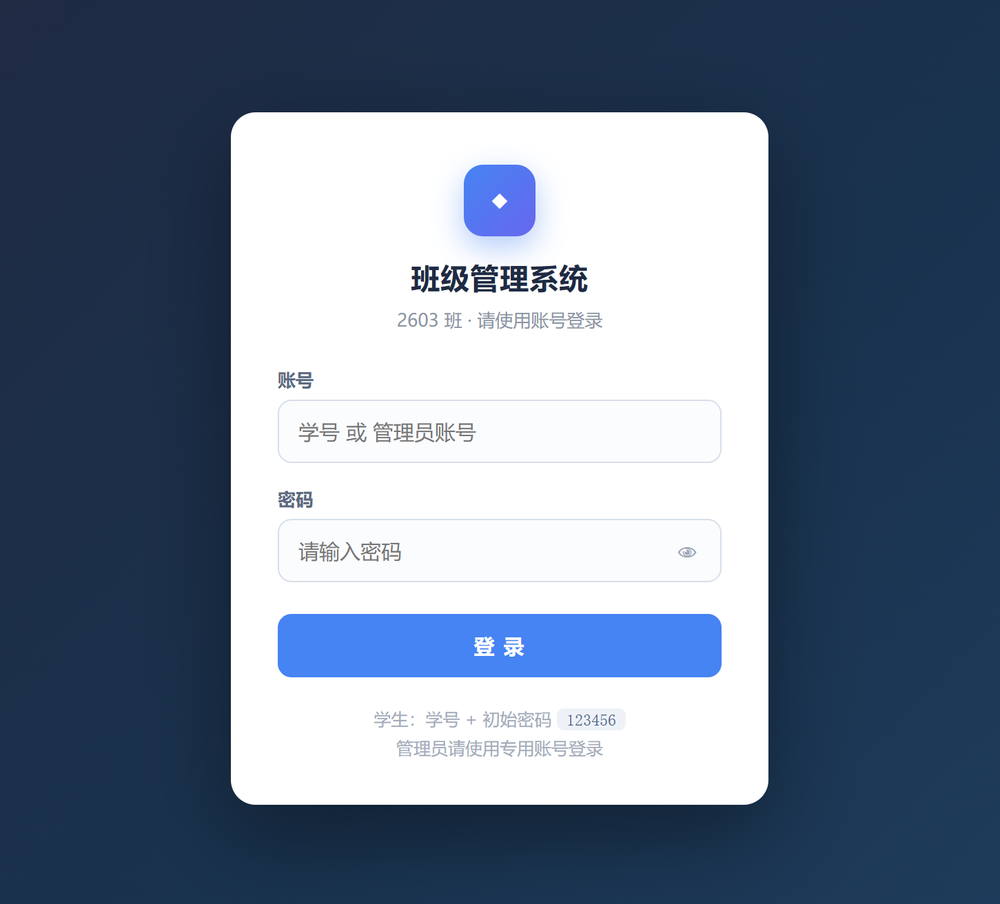
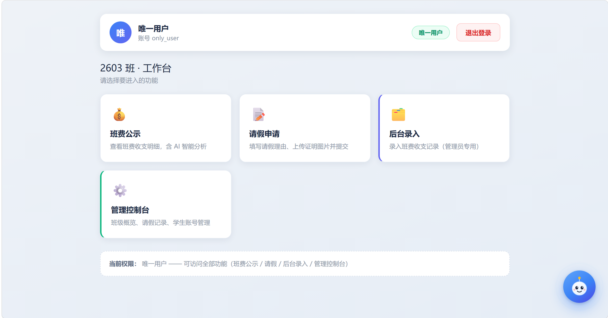
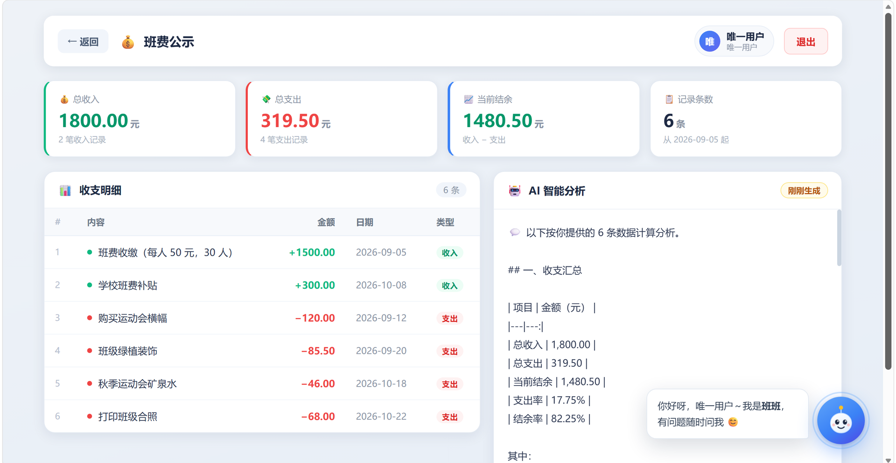
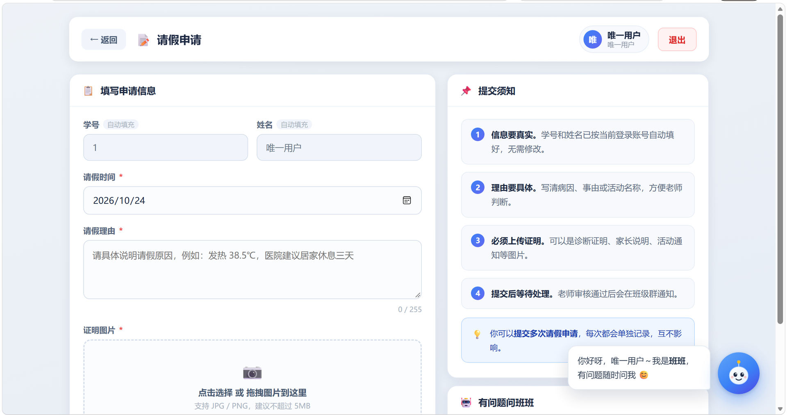
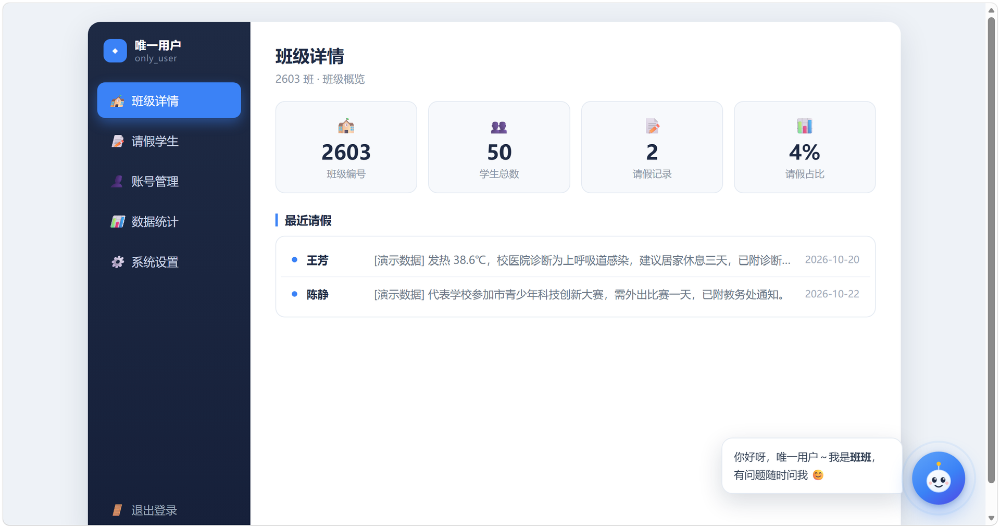
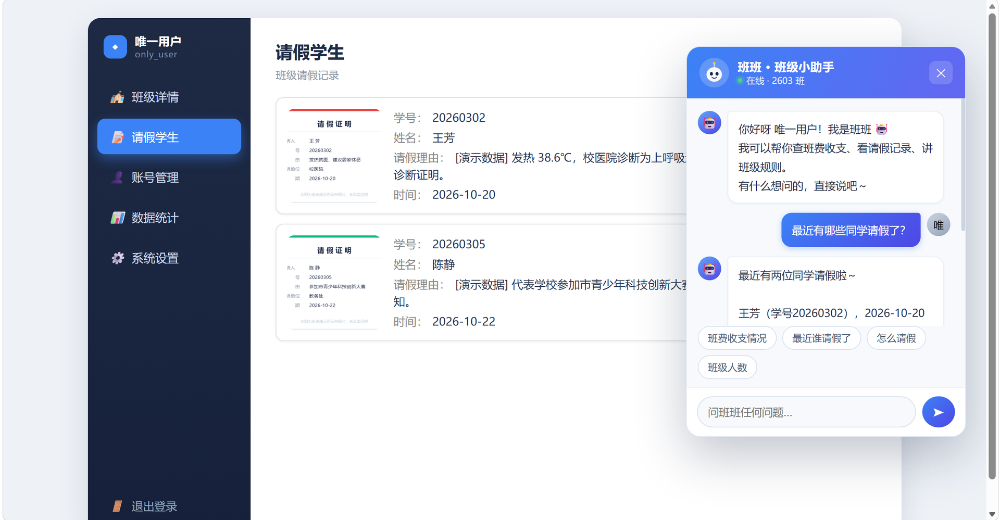

<div align="center">

# 班级管理系统 · chuan_zhi_web

**一个给班级用的轻量管理系统：班费公示、请假申请、AI 助教**

Flask · MySQL · DeepSeek · 阿里云部署

</div>

---

## 目录

- [一、项目简介](#一项目简介)
- [二、功能截图](#二功能截图)
- [三、核心功能](#三核心功能)
- [四、技术栈](#四技术栈)
- [五、系统架构](#五系统架构)
- [六、数据库设计](#六数据库设计)
- [七、权限设计](#七权限设计)
- [八、AI 助教设计](#八ai-助教设计)
- [九、目录结构](#九目录结构)
- [十、本地运行](#十本地运行)
- [十一、部署说明](#十一部署说明)
- [十二、安全设计](#十二安全设计)
- [十三、已知限制与后续计划](#十三已知限制与后续计划)

---

## 一、项目简介

班上的班费一直是"记在手机备忘录里、发在群聊里"的状态 —— 月底同学想查某笔钱花在哪了，
得往上翻几百条消息；有人要请假，得在群里 @ 班长，班长再手动记到 Excel；时间一长，
记录和实际对不上，谁也不敢确定账是不是平的。

这个项目把这三件事搬到一个网站上：**班费公开可查、请假在线提交、账目自动汇总**，
并且接入了大模型，让班费分析和对同学提问的回答都不用人工整理。

**一句话介绍：** 把班费、请假都收进一个网站，同学用学号登录就能查、能提交，
班委和管理员用不同身份做不同的事。

**解决的三个问题：**

| 问题 | 以前怎么处理 | 现在怎么处理 |
|---|---|---|
| 班费不透明 | 记账在手机备忘录，账目发在群里，往上翻很难找 | 班费公示页，每笔收支可查，还有 AI 自动分析 |
| 请假不方便 | 群里 @ 班长，班长手动记到 Excel，容易漏记 | 在线填写 + 上传证明图片，一次提交 |
| 通知靠群刷屏 | 关键通知混在聊天记录里，翻不到 | 登录后的工作台，按身份显示要办的事 |

**开发者：** <!-- 陈子杰-广东生态工程职业学院-专业：软件技术 -->
**开发时间：** 2026 年 10 月

---

## 二、功能截图

**截图已放在 `docs/images/` 目录下，共 6 张。** 如果图片没显示，说明该目录下还没有对应文件。

### 1. 登录页

> 支持账号密码登录，密码显示/隐藏切换，登录后按身份自动跳到对应首页。

### 2. 学生工作台

> 顶部显示当前登录人和角色，下方只显示该身份能用的功能入口。

### 3. 班费公示

> 4 个统计卡（总收入 / 总支出 / 结余 / 记录数）+ 明细表 + AI 分析面板。

### 4. 请假申请

> 学号姓名自动填充且只读，支持拖拽上传证明图片并预览。

### 5. 管理控制台

> 5 个面板：班级详情、请假学生、账号管理、数据统计、系统设置。

### 6. AI 助教「班班」

> 全站悬浮的卡通助教，读数据库回答问题。

---

## 三、核心功能

| 模块 | 功能点 | 谁能用 |
|---|---|---|
| **登录** | 账号密码登录、scrypt 加盐哈希、登录后按角色跳转 | 所有人 |
| **班费公示** | 收支统计、明细表格、AI 智能分析 | 登录后 |
| **请假申请** | 表单填充、图片上传预览、前端校验、提交入库 | 登录后 |
| **后台录入** | 班费记账（收入/支出）、表单校验 | 超级用户 / 唯一用户 |
| **管理控制台** | 班级概览、请假记录、学生账号管理（增删查） | 唯一用户 |
| **AI 助教** | 全站悬浮、自然语言问答、读数据库回答 | 登录后 |
| **权限控制** | 三级角色、全站强制登录、403 拦截、接口 401/403 | 全局 |

---

## 四、技术栈

### 后端

| 技术 | 版本 | 用途 |
|---|---|---|
| Python | 3.8+ | 运行环境（服务器 3.8，本地 3.14 均可） |
| Flask | 3.x | Web 框架，路由 + 模板渲染 |
| PyMySQL | 1.1+ | MySQL 驱动，全部使用参数化查询 |
| python-dotenv | 1.x | 从 `.env` 读取配置，密码不进代码 |
| Werkzeug | 3.x | 密码 scrypt 哈希 |
| Gunicorn | 23.x | 生产环境 WSGI 服务器 |

### 数据库

| 技术 | 版本 | 用途 |
|---|---|---|
| MySQL | 8.x | 存储班费、请假、账号三张表 |

### AI

| 技术 | 用途 |
|---|---|
| DeepSeek `deepseek-flash` | 班费分析 + 助教问答 |
| OpenAI SDK | 通过 OpenAI 兼容接口调用 DeepSeek |

### 前端

| 技术 | 用途 |
|---|---|
| Jinja2 模板 | 服务端渲染页面 |
| 原生 JavaScript | DOM 操作、表单交互、fetch 请求 |
| 内联 CSS | 每个页面独立样式，无需构建 |

> **关于前端选型的说明：** 本项目采用 Jinja2 服务端渲染 + 原生 JS，**没有使用 Vue/React 等框架**。
> 这样选的原因是部署零构建 —— 服务器不需要装 Node.js，改一行模板刷新就能看到效果，
> 对一个班级规模的小系统来说，构建工具带来的复杂度大于收益。
> 项目里已经放入了 Vue 3 的库文件（`static/js/vue.global.prod.js`），
> 当页面交互继续加重（比如控制台要做成单页应用）时，会优先迁移到 Vue 3 组合式 API。

### 部署

| 技术 | 用途 |
|---|---|
| 阿里云 ECS（Alibaba Cloud Linux 3） | 服务器 |
| Nginx 1.24 | 反向代理 80 → 127.0.0.1:5000 |
| systemd | 进程守护，开机自启 + 崩溃自动重启 |

---

## 五、系统架构

```
┌──────────────────────────────────────────────────────────┐
│                        浏览器                             │
│   登录页 / 工作台 / 班费公示 / 请假 / 后台 / 控制台        │
│                 右下角悬浮：AI 助教「班班」                 │
└───────────────────────────┬──────────────────────────────┘
                            │ HTTP :80
                            ▼
┌──────────────────────────────────────────────────────────┐
│                    Nginx（反向代理）                       │
│   · 静态文件 /static/ 直接返回                             │
│   · 其他请求转发到 127.0.0.1:5000                          │
│   · proxy_read_timeout 120s（AI 调用慢，放宽超时）          │
└───────────────────────────┬──────────────────────────────┘
                            │
                            ▼
┌──────────────────────────────────────────────────────────┐
│              Gunicorn（2 个 worker 进程）                  │
└───────────────────────────┬──────────────────────────────┘
                            │
                            ▼
┌──────────────────────────────────────────────────────────┐
│                    Flask 应用（__init__.py）               │
│                                                          │
│  ┌────────────────┐  ┌────────────────┐  ┌────────────┐ │
│  │ before_request │  │ role_required  │  │   routes   │ │
│  │  全站登录拦截   │  │  角色等级校验   │  │  9 个接口   │ │
│  └────────────────┘  └────────────────┘  └────────────┘ │
│                                                          │
│  ┌──────────────────────┐   ┌─────────────────────────┐ │
│  │  models/CLASSSQL.py  │   │   models/AIAPI.py       │ │
│  │  数据库操作 + 建表    │   │   封装 DeepSeek 调用     │ │
│  └──────────┬───────────┘   └───────────┬─────────────┘ │
└─────────────┼───────────────────────────┼───────────────┘
              │                           │
              ▼                           ▼
      ┌───────────────┐          ┌──────────────────┐
      │  MySQL 8.x    │          │  DeepSeek API    │
      │  3 张表        │          │  deepseek-flash  │
      └───────────────┘          └──────────────────┘
```

### 请求处理链路（以访问班费公示为例）

```
① 浏览器 GET /class_funds
        ↓
② Nginx 收到，转发给 127.0.0.1:5000
        ↓
③ Flask before_request：查 session 有没有登录
   ├─ 没登录 → 302 跳 /login?next=/class_funds
   └─ 已登录 → 继续
        ↓
④ 路由函数 class_funds()
   ├─ 连数据库查班费记录
   ├─ compare() 判断数据有没有变（比 md5 指纹）
   │    ├─ 没变 → 用缓存结果（几毫秒）
   │    └─ 变了 → 调 DeepSeek 分析（几秒）
   └─ render_template 渲染 HTML
        ↓
⑤ 浏览器拿到完整 HTML 并显示
```

---

## 六、数据库设计

### 表关系

```
┌─────────────────────┐
│   STUDENTS2603      │  学生账号表
│─────────────────────│
│ student_id   PK     │  学号
│ username     UNIQUE │  登录名（学生=学号，管理员=拼音）
│ name                │  姓名
│ password            │  密码哈希（scrypt）
│ role                │  student / admin / only_user
└──────────┬──────────┘
           │
           │ student_id（逻辑关联，未建外键约束）
           │
           ├───────────────────────────┐
           ▼                           ▼
┌─────────────────────┐     ┌─────────────────────┐
│  CLASS_FUNDS2603    │     │    MONEY2603        │
│─────────────────────│     │─────────────────────│
│ id           PK     │     │ id           PK     │
│ student_id          │     │ content             │  记录流水表
│ name                │     │ money               │
│ picture     BLOB    │     │ kind                │  in / out
│ six_day_reason      │     │ time                │
│ time                │     └─────────────────────┘
└─────────────────────┘
      请假记录表
```

> **说明：** `MONEY2603`（班费流水）和 `CLASS_FUNDS2603`（请假记录）之间没有关联，
> 它们只通过 `student_id` 和学生表产生逻辑联系，没有建物理外键 ——
> 这是为了简化删除操作，约束由应用层保证。

### 表结构详情

#### 1. `STUDENTS2603` — 学生账号表

| 字段 | 类型 | 约束 | 说明 |
|---|---|---|---|
| `student_id` | INT UNSIGNED | PK | 学号 |
| `username` | VARCHAR(50) | NOT NULL, UNIQUE | 登录名 |
| `name` | VARCHAR(50) | NOT NULL | 姓名 |
| `password` | VARCHAR(255) | NOT NULL | 密码哈希（**非明文**） |
| `role` | VARCHAR(20) | NOT NULL, 默认 `student` | 角色 |

#### 2. `MONEY2603` — 班费流水表

| 字段 | 类型 | 说明 |
|---|---|---|
| `id` | INT | 主键，自增 |
| `content` | VARCHAR(255) | 这笔钱是什么 |
| `money` | DECIMAL(10,2) | 金额（**一律存正数**） |
| `kind` | VARCHAR(10) | `in`=收入 / `out`=支出 |
| `time` | DATE | 发生日期 |

> **设计说明：** 金额统一存正数，收支方向单独用 `kind` 字段表示。
> 这样统计总收入/总支出时可以直接按 `kind` 分组，不用靠金额正负号推断。

#### 3. `CLASS_FUNDS2603` — 请假记录表

| 字段 | 类型 | 说明 |
|---|---|---|
| `id` | INT UNSIGNED | 主键，自增 |
| `student_id` | INT UNSIGNED | 学号（普通索引，允许同一人多次请假） |
| `name` | VARCHAR(50) | 姓名 |
| `picture` | MEDIUMBLOB | 证明图片的二进制数据 |
| `six_day_reason` | VARCHAR(255) | 请假理由 |
| `time` | DATE | 请假时间 |

> **设计说明：** 图片直接存数据库而不是存文件系统，好处是备份简单、不会出现
> "数据库有记录但文件丢了"的情况。缺点是数据库会变大，所以限制单张图片大小。

---

## 七、权限设计

### 三级角色

| 角色 | 代号 | 等级 | 说明 |
|---|---|:---:|---|
| 普通用户 | `student` | 1 | 班里同学 |
| 超级用户 | `admin` | 2 | 班委，能记账 |
| 唯一用户 | `only_user` | 3 | 管理员，能管所有事 |

### 权限矩阵

| 页面 / 接口 | 未登录 | `student` | `admin` | `only_user` |
|---|:---:|:---:|:---:|:---:|
| `/login` `/logout` `/static/*` | ✅ 公开 | ✅ | ✅ | ✅ |
| `/` 工作台 | 302→登录 | ✅ | ✅ | ✅ |
| `/class_funds` 班费公示 | 302→登录 | ✅ | ✅ | ✅ |
| `/six_day` 请假申请 | 302→登录 | ✅ | ✅ | ✅ |
| `/superuser` 后台录入 | 302→登录 | ❌ 403 | ✅ | ✅ |
| `/only_user` 管理控制台 | 302→登录 | ❌ 403 | ❌ 403 | ✅ |
| `/api/add_student` | 401 | ❌ 403 | ✅ | ✅ |
| `/api/assistant` 助教 | 401 | ✅ | ✅ | ✅ |

### 实现方式

**两层拦截：**

```python
# 第一层：全站强制登录（before_request，新加路由自动受保护）
@app.before_request
def require_login_everywhere():
    if request.endpoint in PUBLIC_ENDPOINTS:
        return None
    if not session.get("student_id"):
        return redirect(url_for("login", next=request.path))

# 第二层：角色等级校验（装饰器，只贴需要限制的页面）
@app.route('/only_user')
@role_required("only_user")
def only_user(): ...
```

**为什么用两级而不是给每个页面都贴装饰器？**

> 全站登录用 `before_request`，新增页面不会忘；
> 角色限制用装饰器，因为只有 3 个页面需要限制，写装饰器更直观。

### 登录流程图

```
输入账号密码
      ↓
POST /login
      ↓
按 username 查 STUDENTS2603
      ↓
check_password_hash(数据库哈希, 输入密码)
      ├─ 失败 → 401「账号或密码错误」（不区分是账号错还是密码错）
      └─ 成功 → 写 session（学号/账号/姓名/角色）
             ↓
        按角色跳转：
           only_user → /only_user
           admin     → /superuser
           student   → /
```

---

## 八、AI 助教设计

### 做了什么

「班班」是一个**懂班级数据的对话助手**，出现在除登录页外的所有页面右下角。

### 核心机制：上下文注入

```
用户提问「班费还剩多少」
        ↓
① 查数据库，汇总成一段文字
   ├─ 学生总数 50 人
   ├─ 班费 5 条记录（含金额和收支方向）
   └─ 请假 2 条记录
        ↓
② 拼成完整提示词
   ┌──────────────────────────────┐
   │ 【角色设定】你是班班...       │
   │ 【当前提问的同学】李娜/学号... │
   │ 【班级实时数据】...           │
   └──────────────────────────────┘
        ↓
③ 把「提示词 + 用户问题」一起发给 DeepSeek
        ↓
④ AI 基于真实数据生成回答
        ↓
⑤ 返回给前端显示
```

**关键点：AI 本身不知道班级数据，每次提问时把最新数据"喂"给它。
所以数据一变，回答立刻就变，不需要重新训练模型。**

### 班费分析缓存

```
访问 /class_funds
        ↓
查数据库拿到班费记录
        ↓
算 md5 指纹（数据一样，指纹就一样）
        ↓
指纹和上次一样？
   ├─ 是 → 直接返回上次的 AI 分析（几毫秒）
   └─ 否 → 调 DeepSeek 重新分析（几秒），并更新缓存
```

**效果：** 第一次访问 5~10 秒，之后刷新都是几十毫秒。

### 后续计划

> 目前 AI 只做到"上下文注入"这一步。下面三步是明确的技术演进路线，
> 每一小步都能独立交付，不会影响现在能用的功能。

```
现状：上下文注入（把数据塞进提示词）
      ↓
下一步 1：工具调用（Tool Calling）
   给 AI 三个工具：查班费 / 查请假 / 统计人数
   让 AI 自己决定该调哪个，而不是每次把所有数据都塞进去
      ↓
下一步 2：RAG 知识库
   把班级规章制度做成向量库
   问到"请假要提前多久"时，检索制度原文再回答，并标出来源
      ↓
下一步 3：多模态
   DeepSeek 目前不支持看图，
   需要换支持视觉的模型，才能识别请假证明图片的内容
```

---

## 九、目录结构

```
chuan_zhi_web/
├── __init__.py                 Flask 主程序：路由、权限、AI 助教
├── requirements.txt            依赖清单
├── .env                        配置（数据库密码、API Key）★ 不进仓库
├── .gitignore                  版本控制忽略规则
│
├── models/
│   ├── CLASSSQL.py             数据库操作：连接、建表、增删查
│   └── AIAPI.py                封装 DeepSeek 调用
│
├── scripts/
│   └── init_server_db.py       一键初始化数据库（建表 + 灌数据）
│
├── templates/
│   ├── login.html              登录页
│   ├── index.html              工作台首页
│   ├── class_funds.html        班费公示
│   ├── six_day.html            请假申请
│   ├── superuser.html          后台录入
│   ├── only_user.html          管理控制台
│   ├── 403.html                无权限页
│   └── _assistant.html         AI 助教组件（被其他页面 include）
│
└── static/
    └── js/
        └── vue.global.prod.js  Vue 3 库文件
```

> **说明：** 静态样式写在各模板的 `<style>` 里，没有单独的 CSS 文件。
> 好处是一个页面就是一个文件，改样式不用在多个文件间跳。
> 如果页面继续变多，会拆出公共 CSS。

---

## 十、本地运行

### 1. 准备环境

```bash
# 需要 Python 3.8 或以上、MySQL 8.x
python --version
mysql --version
```

### 2. 克隆并安装依赖

```bash
git clone https://github.com/你的用户名/chuan_zhi_web.git
cd chuan_zhi_web

python -m venv .venv
# Windows
.venv\Scripts\activate
# Linux / macOS
source .venv/bin/activate

pip install -r requirements.txt
```

### 3. 配置 `.env`

**在项目根目录新建 `.env`：**

```ini
# DeepSeek 大模型
DEEPSEEK_API_KEY=sk-你的Key
DEEPSEEK_BASE_URL=https://api.deepseek.com
DEEPSEEK_MODEL=deepseek-flash

# Flask 登录加密用（随便写一串随机字符）
SECRET_KEY=change-me-to-a-random-string

# MySQL
MYSQL_HOST=127.0.0.1
MYSQL_PORT=3306
MYSQL_USER=root
MYSQL_PASSWORD=你的数据库密码
MYSQL_DB=class2603

# 初始化数据库时用到的初始密码（只被 init_server_db.py 读取）
# 不填的话脚本会随机生成并打印一次
ADMIN_PWD_ONLY_USER=给唯一用户设的密码
ADMIN_PWD_SUPERUSER=给超级管理员设的密码
STUDENT_INIT_PWD=123456
```

> ⚠️ `.env` 已经在 `.gitignore` 里，**不会**被提交到仓库。
> 仓库里也**没有任何默认密码** —— 所有密码都只存在于各人的 `.env` 里。

### 4. 初始化数据库

```bash
mysql -u root -p -e "CREATE DATABASE IF NOT EXISTS class2603 DEFAULT CHARSET utf8mb4;"
python scripts/init_server_db.py
```

输出示例：
```
① 检查/创建数据表  ✅ money ✅ funds ✅ students
② 写入 50 个学生账号
③ 写入管理员账号
   ✅ only_user    唯一用户     角色 only_user  密码已设置（N 位）
   ✅ superuser    超级管理员   角色 admin      密码已设置（N 位）
🎉 数据库初始化完成
```

### 5. 启动

```bash
python __init__.py
```

浏览器打开 <http://127.0.0.1:5000>

### 6. 账号说明

| 账号 | 密码 | 角色 |
|---|---|---|
| `only_user` | 由 `.env` 里的 `ADMIN_PWD_ONLY_USER` 决定 | 唯一用户 |
| `superuser` | 由 `.env` 里的 `ADMIN_PWD_SUPERUSER` 决定 | 超级管理员 |
| `20260301` ~ `20260350` | 由 `.env` 里的 `STUDENT_INIT_PWD` 决定，默认 `123456` | 普通用户 |

> **为什么仓库里不写死管理员密码：**
> 这个站点是公网可访问的，如果把管理员密码写进 README，任何人 clone 仓库就能拿到线上后台的账号。
> 所以管理员密码只存在于服务器的 `.env` 里，代码和文档里都不出现。
>
> 如果 `.env` 里没有配置这两个变量，`init_server_db.py` 会**随机生成**一个密码并打印一次，
> 记得把打印出来的密码记下，或者写进 `.env` 后重新运行脚本。

---

## 十一、部署说明

> **线上地址：** <http://8.134.74.84> （阿里云轻量应用服务器，2 核 2G）

### 部署环境

```
阿里云 ECS · Alibaba Cloud Linux 3 · 2 核 2G
Python 3.8.17 · MySQL 8.x · Nginx 1.24 · Gunicorn 23
公网 IP：8.134.74.84
```

### 部署步骤

```bash
# ① 上传代码
tar -xzf chuan_zhi_web.tar.gz -C ~/chuan_zhi_web

# ② 建虚拟环境
cd ~/chuan_zhi_web
python3.8 -m venv venv
source venv/bin/activate
pip install -r requirements.txt

# ③ 配置 .env（同本地，但路径和密码按服务器填）
#    ★ 不要从本地上传 .env，在服务器上手写

# ④ 初始化数据库
python scripts/init_server_db.py

# ⑤ 配置 Nginx 反向代理
sudo nano /etc/nginx/conf.d/chuan_zhi_web.conf
```

**Nginx 配置：**

```nginx
server {
    listen 80;
    server_name 你的IP或域名;

    location / {
        proxy_pass http://127.0.0.1:5000;
        proxy_set_header Host $host;
        proxy_set_header X-Real-IP $remote_addr;
        proxy_set_header X-Forwarded-For $proxy_add_x_forwarded_for;
        proxy_read_timeout 120s;      # AI 调用慢，超时要放宽
    }
}
```

```bash
# ⑥ 配置 systemd 守护进程
sudo nano /etc/systemd/system/chuan_zhi_web.service
```

```ini
[Unit]
Description=ChuanZhiWeb Flask App
After=network.target

[Service]
Type=simple
User=admin
Group=admin
WorkingDirectory=/home/admin/chuan_zhi_web
Environment="PATH=/home/admin/chuan_zhi_web/venv/bin"
ExecStart=/home/admin/chuan_zhi_web/venv/bin/gunicorn \
    -w 2 -b 127.0.0.1:5000 __init__:app \
    --access-logfile /home/admin/chuan_zhi_web/access.log \
    --error-logfile /home/admin/chuan_zhi_web/error.log
Restart=always
RestartSec=5

[Install]
WantedBy=multi-user.target
```

```bash
# ⑦ 启动
sudo systemctl daemon-reload
sudo systemctl enable --now chuan_zhi_web
sudo systemctl status chuan_zhi_web
```

### 常用运维命令

```bash
sudo systemctl status chuan_zhi_web      # 看状态
sudo systemctl restart chuan_zhi_web     # 改完代码重启
sudo journalctl -u chuan_zhi_web -f      # 看实时日志
tail -f ~/chuan_zhi_web/error.log        # 看 Gunicorn 错误
```

---

## 十二、安全设计

| 措施 | 做法 | 防住什么 |
|---|---|---|
| **密码不存明文** | Werkzeug `generate_password_hash`（scrypt + 随机盐） | 数据库泄露 = 密码泄露 |
| **每人独立盐值** | 哈希时自动加随机盐 | 撞库（相同密码哈希不同） |
| **配置不进代码** | 数据库密码、API Key 全在 `.env` | 代码泄露 = 数据库泄露 |
| **启动自检** | 缺配置直接抛错，不会带着错配置跑起来 | 部署时漏配环境变量 |
| **SQL 参数化** | 全部用 `%s` 占位符 | SQL 注入 |
| **XSS 防护** | 模板不滥用 `\|safe`，JS 用 `textContent` | 恶意脚本注入 |
| **开放重定向防护** | `next` 参数只接受 `/` 开头且当前角色有权限的地址 | 被跳转到钓鱼站 |
| **统一错误提示** | 登录失败一律提示"账号或密码错误" | 攻击者枚举有效账号 |
| **接口与页面分离返回** | `/api/*` 返回 JSON，页面返回 403 页 | 前端解析失败 |
| **全站强制登录** | `before_request` 统一拦截 | 漏加装饰器导致页面裸奔 |

> **还没做但已经想到的：** 目前没有启用 CSRF 防护、登录无限流、站点只有 HTTP。
> 这三项都写进了[第十三节](#十三已知限制与后续计划)的计划表，是下一步要补的。

---

## 十三、已知限制与后续计划

### 当前限制

| # | 限制 | 影响 | 计划 |
|---|---|---|---|
| 1 | 没有 CSRF 保护 | 极端情况下可能被跨站伪造提交 | 计划引入 Flask-WTF |
| 2 | 登录接口没有限流 | 可以无限次尝试密码 | 计划加失败次数限制 |
| 3 | 上传图片没有大小限制 | 超大图片可能撑爆数据库 | 计划限制单张 5MB |
| 4 | 只有 HTTP，没有 HTTPS | 密码明文传输 | 计划申请免费 SSL 证书 |
| 5 | AI 是上下文注入，不是 RAG | 数据量大了会超上下文长度 | 计划做向量检索 |
| 6 | AI 不会调用工具 | 所有数据都塞进提示词，不够优雅 | 计划改造成 Tool Calling |
| 7 | 无单元测试 | 改代码靠手测 | 计划补核心接口测试 |
| 8 | 数据库连接每请求新建 | 并发高时开销大 | 计划引入连接池 |

> **写在这里不是为了扣分，是为了说清楚：哪些做到了、哪些还没做、下一步怎么做。**
> 一个知道自己边界在哪的项目，比一个号称"什么都做了"的项目更可信。

### 版本规划

```
v1.0（当前）
  ✅ 登录 + 三级权限
  ✅ 班费公示 + AI 分析
  ✅ 请假申请 + 图片上传
  ✅ 管理控制台
  ✅ AI 助教
  ✅ 阿里云部署

v1.1（计划中）
  □ CSRF 保护 + 登录限流
  □ 上传大小限制
  □ HTTPS
  □ 单元测试

v2.0（计划中）
  □ AI 改造成 Tool Calling
  □ 增加 RAG 知识库（班级规章制度问答）
  □ 前端迁移 Vue 3
```

---

<div align="center">

**如果这个项目对你有帮助，欢迎点个 ⭐**

</div>
